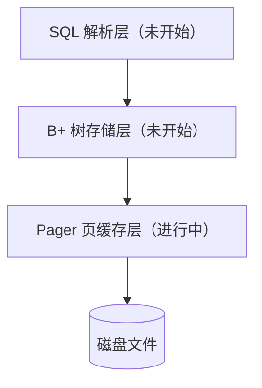

# MiniSQL

从零手写一个数据库引擎，用 C11 实现 **Pager（页缓存管理器）**，后续叠加 **B+ 树** 与 SQL 解析层。
纯 POSIX，零第三方依赖。

> ⚠️ **开发中**：Pager 层接近完成，B+ 树与 SQL 层尚未开始。
> 这是一个「边写边学」的项目 —— 目标是能讲清楚存储引擎里每一行代码**为什么存在**，而不只是让它跑起来。

---

## 为什么写这个

教科书会告诉你「数据库用 B+ 树存数据、用 LRU 管理缓存」，但从原理到能跑的代码之间隔着大量工程细节：

- 脏页什么时候写回？写回失败怎么办？
- 缓存满了驱逐谁？被 pin 住的页能不能驱逐？
- `pwrite` 只写了一半怎么办？返回 `EINTR` 要不要重试？
- 同一个页被加载两份会怎样？（答案是：数据静默损坏）

这些细节不写代码就永远学不到。本项目只为把它们逐个搞清楚而存在，每个函数都有明确的设计理由。

---

## 架构



### 分层职责

| 层 | 负责 | 明确不负责 |
|---|---|---|
| Pager | 磁盘页 ↔ 内存页框、缓存淘汰、脏页写回、引用计数 | **解析页内字节** |
| B+ 树 | 节点布局、分裂合并、索引查找 | 文件 IO |

**「Pager 不解析页内容」是贯穿整个项目的核心边界。** Pager 只保证「第 N 页的 4096 字节被正确读入内存、正确写回磁盘」，至于这 4096 字节里是 B+ 树节点还是文件头，它完全不知道。这条边界让存储层可以独立演进而互不牵连。

---

## 核心设计

### 页号与偏移

```
页 0        = 文件头页（魔数、版本、root_page、freelist_head）
页 1..N     = 数据页
offset(pgno) = pgno * 4096        ← 全项目唯一恒等式，任何地方都不加额外偏移
```

`MINISQL_PGNO_NULL = 0xFFFFFFFF` 表示「无此页」。注意**不能**用 `0` 表示空，因为 `0` 是合法的头页号。

### 缓存结构：两套独立的链

同一个页框同时挂在两条链上，职责完全不同：

| 结构 | 用途 | 实现 |
|---|---|---|
| 哈希表 | 按 `pgno` **定位**页框，$O(1)$ | `buckets[]` + `hnext` 单链表；下标 `pgno & hash_mask` |
| LRU 链 | 管理**淘汰顺序** | `lru_head`/`lru_tail` + `lru_prev`/`lru_next` 双向链表 |

`cache_capacity` 向上取整到 2 的幂（`round_up_pow2`），于是 `hash_mask = capacity - 1`，桶下标用位与替代取模 —— 位与是单条 CPU 指令，取模是几十个周期。

另有 `free_frames` 单链复用 `lru_next` 字段，串起尚未使用过的页框。**同一个字段在任一时刻只属于其中一条链**，因此出链时必须把 `lru_prev`/`lru_next`/`hnext` 全部清空。

### 驱逐策略（LRU，含 pinned 页）

LRU 链包含**所有已加载的页，包括被 pin 住的**。分配新页框时：

1. 先试 `free_frames`，摘链头，$O(1)$；
2. 空闲链空了，从 `lru_tail` 沿 `lru_prev` 向 MRU 方向扫，找第一个 `pin == 0` 的受害者；
3. 扫到 `NULL` 说明全部 pinned → 返回 `MINISQL_ERR_CACHE_FULL`（合法运行时状态，不是崩溃条件）。

`pin` 是**引用计数**而非布尔值：一个页可以被多处同时持有，只有减到 0 才允许被驱逐。

### 脏页与写回

`dirty` 是**粘性**的：一旦置位，只有写盘成功才能清除。

批量写回（`pager_flush`）采用「**尽力而为**」策略：

- 单个页写失败 → **保留脏位**、记录首个错误 → **继续写后面的页**；
- 不提前 `return`（否则后面的脏页永远写不出去）；
- 全部尝试完后统一 `fsync`，且只在「确实写过东西」时才 `fsync`。

这是数据库的典型取舍：**宁可部分成功并报告错误，也不要因为一页失败就放弃其余页**。

### 错误处理约定

| 场景 | 做法 |
|---|---|
| 系统调用返回 `-1` | 紧跟其后用 `minisql_errno_sys(errno)` 映射 |
| 参数非法 | 用固定错误码 `MINISQL_ERR_INVALID`，**不读 `errno`** |
| 批量操作中出错 | 保留原状、记首个错误、不中断 |

**`errno` 只在系统调用返回 `-1` 的紧邻位置有效。** 参数校验分支里 `errno` 是上一次调用留下的残值，读它必然出错。

### 失败不改状态

所有可能失败的函数都保证**要么完全成功、要么什么都没变**：

- `frame_acquire` 写回失败 → 受害者原封不动留在缓存里，下次还能再试；
- `pager_get` 读盘失败 → 页框退回空闲链，`cache_count` 复原；
- `pager_unpin` 遇到非法 `pin` → 立即拦截，不执行减一。

这条原则的价值在于：**调用方不需要处理「部分成功」的中间状态**。

---

## 进度

- [x] 错误码体系与 `strerror` 映射
- [x] `pager_open`：打开/创建文件、校验大小、建空闲链、初始化页框
- [x] `page_data` / `pager_page_count`
- [x] 哈希层：`hash_find` / `hash_insert` / `hash_remove`
- [x] LRU 层：`lru_remove` / `lru_push_front` / `lru_touch`
- [x] `pager_write_page`：处理 `pwrite` 部分写 + `EINTR` 重试
- [x] `pager_unpin`：引用计数递减，归零时 touch
- [x] `pager_flush` / `pager_close`
- [x] `frame_acquire`：空闲链 + LRU 驱逐
- [ ] `pager_get`：缓存命中与未命中路径
- [ ] `pager_alloc` / `pager_free`
- [ ] B+ 树节点与增删查
- [ ] SQL 解析

---

## 构建

需要 C11 编译器与 CMake ≥ 3.20，无第三方依赖。

```bash
cmake -B build -DCMAKE_BUILD_TYPE=Debug
cmake --build build
ctest --test-dir build --output-on-failure
```

## 目录结构

```
include/minisql/
  common.h      错误码、页大小、页号类型、编译期断言
  pager.h       Pager 对外接口
src/
  common.c      错误码 ↔ 系统 errno 的双向映射
  pager.c       页缓存实现（哈希 + LRU + 磁盘 IO）
  db.c          上层数据库对象（待实现）
  main.c        入口
tests/
  test_pager.c  Pager 层测试
```

---

## 参考

- SQLite 的 pager 设计（`btree.c` / `pager.c`）
- CMU 15-445 Database Systems
- 《Database Internals》(Alex Petrov)