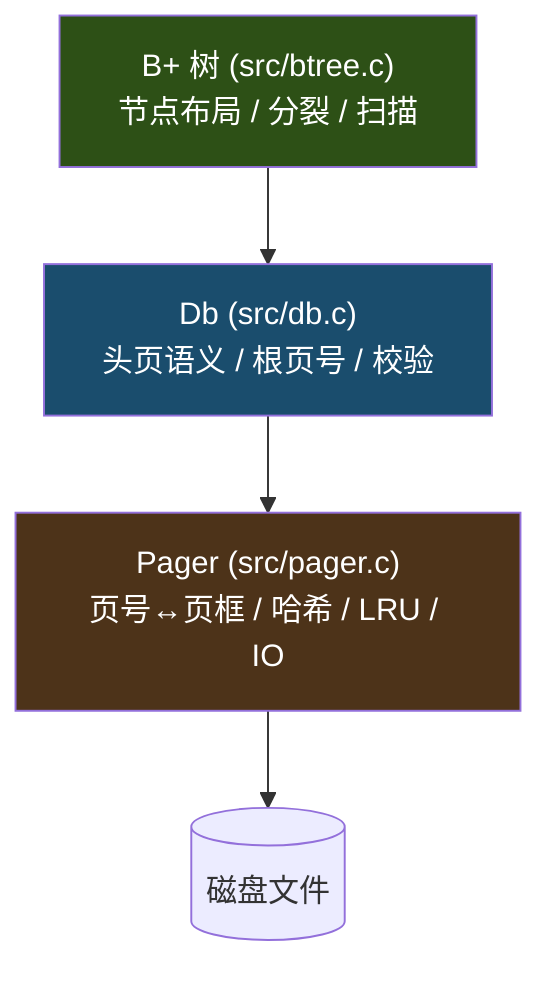

# MiniSQL

用 C11 从零手写的 B+ 树存储引擎。零第三方依赖 —— 只有 POSIX 和 libc。

三层，逐层往上学：

| 层 | 文件 | 行数 | 职责 |
|---|---|---|---|
| **Pager** | `src/pager.c` | 638 | 磁盘页 ↔ 内存页框、哈希定位、LRU 淘汰、脏页写回、引用计数 |
| **Db** | `src/db.c` | 231 | 头页语义（魔数/版本/页数/根页/freelist） |
| **B+ 树** | `src/btree.c` | 995 | 节点布局、二分查找、分裂、删除、范围扫描、不变量自检 |

**912 个断言全绿**（178 pager + 590 btree + 144 db），ASan + UBSan 下无任何报错。

这不是一个能跑 SQL 的数据库 —— 它没有词法/语法分析层，也不打算有。目标是**把存储引擎的每一层都写到能讲清「这行代码为什么存在」**，而不是让它看起来像个数据库。

---

## 为什么写这个

教科书会说「数据库用 B+ 树存数据、用 LRU 管理缓存」，但从这句话到能跑的代码之间，隔着一堆只有动手才会撞上来的问题：

- 脏页什么时候写回？写回失败一页，剩下的页还写不写？
- 缓存满了驱逐谁？被 pin 住的页能不能驱逐？
- 同一个页被加载两份会怎样？（答案：数据静默损坏，且不报错）
- 页内偏移 `+8` 处放个 `uint32`，强转指针去读会崩吗？（x86 不会，ARM 直接 SIGBUS）
- 叶子分裂时中间那个 key 是**复制**上去还是**移走**？内部节点呢？

最后两个问题是本项目真实踩过的坑，详见「踩过的坑」。

---

## 架构



### 分层职责与边界

| 层 | 负责 | **明确不负责** |
|---|---|---|
| Pager | 页号 ↔ 内存页框、缓存淘汰、脏页写回、pin 计数 | **解析页内任何一个字节** |
| Db | 页 0 的字段含义、打开时校验、根页号存取 | 节点布局、分裂逻辑 |
| B+ 树 | 节点字节布局、key 比较、分裂、扫描遍历 | 文件 IO、页号分配 |

**「Pager 不解析页内容」是整个项目的核心边界。** Pager 只知道「第 N 页的 4096 字节要被正确读进来、正确写回去」，里面是 B+ 树节点还是文件头，它一无所知。受益很直接：`pager.c` 的 178 个测试完全不需要构造合法的 B+ 树节点，随便写什么字节都能测。

B+ 树层则相反：它**只通过** `db_pager()` 拿到 pager，用 `pager_get` / `pager_alloc` / `pager_unpin` 三个原语操作世界，从不碰 `pread`。

> 顺带一个设计细节：`btree.h` 故意**不暴露** `minisql_db` 的内部结构，根页号只存在 db 头页的 `root_page` 字段里，`minisql_btree` 里不留副本。代价是查一次根页号要读一次 pager（几乎必然命中缓存），收益是**不存在「对象内的根页号」和「磁盘上的根页号」不一致的可能**。

---

## 磁盘布局

```
页 0        = 头页
页 1..N-1   = 数据页（B+ 树节点），空闲页通过 freelist 串起来

offset(pgno) = pgno * 4096      ← 全项目唯一恒等式，任何地方都不加额外偏移
```

### 头页（`src/db.c`）

| 偏移 | 类型 | 字段 |
|---|---|---|
| 0 | `char[8]` | magic `"MINISQL\0"` |
| 8 | `uint32` | version（当前 `1`） |
| 12 | `uint32` | page_count（物理页数） |
| 16 | `pgno` | root_page（`0xFFFFFFFF` = 空树） |
| 20 | `pgno` | freelist_head（`0xFFFFFFFF` = 无空闲页） |

`MINISQL_PGNO_NULL = 0xFFFFFFFF` 表示「无此页」。**绝不能**用 `0` 表示空 —— `0` 是合法的头页号。

打开时的校验顺序（任何一条不过就返回 `MINISQL_ERR_CORRUPT`，且**不改动 `*db_out`**）：

1. 头页全零 → 视为新建库，初始化
2. magic 不匹配 → `CORRUPT`
3. version 不匹配 → `CORRUPT`
4. `page_count != 文件实际页数` → `CORRUPT`。**以文件大小为权威** —— 头页说 5 页但文件只有 1 页，说明文件被截断了，这不是能自动修复的状态
5. `root_page` / `freelist_head` 不在 `[1, page_count)` 且不为 NULL → `CORRUPT`

### B+ 树节点页（`src/btree.c`）

叶子和内部节点共用同一个 8 字节 header：

```
偏移 0  uint8   is_leaf      1 = 叶子, 0 = 内部
偏移 1  uint8   reserved     恒 0
偏移 2  uint16  nkeys        cell 个数
偏移 4  pgno    link
          叶子 -> 下一个叶子的页号（叶子链）
          内部 -> 最右孩子的页号
偏移 8  cell[]  每个 8 字节，按 key 升序

  叶子 cell = key(4B) + value(4B)
  内部 cell = key(4B) + child_pgno(4B)
```

为什么内部节点的最右孩子放 `link` 而不是多一个 cell？因为 $n$ 个 key 天然有 $n+1$ 个孩子。把最右孩子塞进 header 的 `link` 字段，`cell[i].child` 就能规整地对应「小于 `keys[i]` 的那一岔」，cell 数组不需要特殊对待最后一个元素。

**内部节点搜索语义（所有代码都依赖这一条）：**

```
children[i]      = cells[i].child        i ∈ [0, nkeys)
children[nkeys]  = header.link

children[i] 子树里的 key ∈ [ keys[i-1], keys[i] )
children[nkeys] 子树里的 key ∈ [ keys[nkeys-1], +∞ )

走哪个孩子：取第一个满足 key < keys[i] 的 i；没有则走 link
```

这就是 `bt_upper_bound`（第一个 `> key` 的下标）—— 它返回的值**直接**就是孩子下标，不用再判断。

### 扇出推导

$$n_{\max} = \left\lfloor \frac{4096 - 8}{8} \right\rfloor = 511$$

但逻辑上限是 `BT_MAX_KEYS = 510`，**故意留一格**。原因：插入时先无条件塞进去再判断是否溢出，能省掉一次「先查是否已满」的比较。代价是一页的物理容量必须比逻辑上限多一格。

由此：

| 树高 | 满扇出时可容纳 key 数 |
|---|---|
| 1（只有叶子根） | 510 |
| 2 | $510 \times 511 \approx 26$ 万 |
| 3 | $510 \times 511^2 \approx 1.33$ 亿 |

**但实际测出来的树高比理论值更早增长**，因为分裂后两侧各只剩半页（利用率约 50%~70%），实际叶子数远多于理论值：

- 插入 10 万条（存活 8.9 万）→ 树高 **2**
- 插入 20 万条（存活 17.8 万）→ 树高 **3**，共 629 页

按满扇出算 17.8 万条只需约 350 个叶子，仍在单层根之下；实测用了约 620 个叶子页才放下，所以长到了第 3 层。这个「实测比理论早一层」不是 bug，正是分裂策略的直接体现 —— 也是「空间放大率 1.80x」的来源之一。

---

## 核心设计

### 缓存结构：一个页框挂两条链

| 结构 | 用途 | 实现 |
|---|---|---|
| 哈希表 | 按 `pgno` **定位**页框，$O(1)$ | `buckets[]` + `hnext` 单链，下标 `pgno & hash_mask` |
| LRU 链 | 管理**淘汰顺序** | `lru_head` / `lru_tail` + 双向链 |

`cache_capacity` 向上取整到 2 的幂（`round_up_pow2`），于是 `hash_mask = capacity - 1`，桶下标用位与代替取模 —— 位与是单条 CPU 指令，取模是几十个周期。**这就是 `round_up_pow2` 存在的唯一理由。**

另有第三条链 `free_frames`，复用 `lru_next` 字段串起尚未使用的页框。**同一字段在任一时刻只属于一条链**，所以出链时必须把 `lru_prev` / `lru_next` / `hnext` 全清空 —— 忘了清就会得到一条「幽灵链」，症状是随机的野指针崩溃。

### 驱逐策略（LRU 含 pinned 页）

LRU 链包含**所有已加载的页，包括被 pin 住的**。分配新页框时：

1. 先试 `free_frames` 链头，$O(1)$；
2. 空了就从 `lru_tail` 往 MRU 方向扫，找第一个 `pin == 0` 的受害者；
3. 扫到 `NULL` 说明全部 pinned → 返回 `MINISQL_ERR_CACHE_FULL`（**这是合法运行时状态，不是崩溃条件**）。

`pin` 是**引用计数**而非布尔值：同一页可以被多处同时持有（比如 B+ 树分裂时同时持有父页和两个子页），减到 0 才允许被驱逐。

### 脏页与写回

`dirty` 是**粘性**的：一旦置位，只有写盘成功才能清除。

批量写回（`pager_flush`）采用**尽力而为**策略：

- 单页写失败 → **保留脏位**、记录首个错误 → **继续写后面的页**
- 不提前 `return`（否则后面所有脏页永远写不出去）
- 全部尝试完再统一 `fsync`，且只在「确实写过东西」时才 `fsync`

这是数据库的典型取舍：**宁可部分成功并报告错误，也不要因为一页失败就放弃其余页**。

> ⚠️ 一个容易踩的坑：`db_flush` **只把头页标脏，不落盘**。新建库之后头页在磁盘上仍是全零，必须再调一次 `pager_flush` 才真正写入。这是 `db.h` 明确声明的契约，`tests/test_db.c::test_flush_contract` 专门用断言钉住了它。

### 分裂：叶子复制，内部移走

这是本项目最容易写错的一处，两者的中间键处理**完全相反**：

| | 叶子分裂 | 内部节点分裂 |
|---|---|---|
| 中间键 `keys[left_n]` | **复制**一份推上去，原节点保留 | **移走**，原节点不再持有 |
| 为什么 | 叶子里的 key 是真实数据，不能丢 | 内部节点的 key 只是路由用的分隔符，留着会产生重复分隔键 |

叶子分裂还有个细节：右半部分用 `memcpy` 整段复制过去，**右半继承原节点的 `link`**（叶子链的后继），然后左半的 `link` 指向新右半。顺序不能错 —— 先记住原 `link`，否则会把链断掉。

### 失败不改状态

所有可能失败的函数都保证**要么完全成功、要么什么都没变**：

- `frame_acquire` 写回失败 → 受害者原封不动留在缓存，下次再试
- `pager_get` 读盘失败 → 页框退回空闲链，`cache_count` 复原
- `pager_unpin` 遇到非法 `pin` → 立即拦截，不执行减一
- `db_set_root_page` 越界 → 返回 `INVALID`，不改状态

价值在于：**调用方不需要处理「部分成功」的中间态**。`goto` 清理链就是为此服务的 —— 跳到哪个标签，就等于从哪一层开始回滚。

### 错误处理约定

| 场景 | 做法 |
|---|---|
| 系统调用返回 `-1` | 紧跟其后用 `minisql_errno_sys(errno)` 映射 |
| 参数非法 | 固定返回 `MINISQL_ERR_INVALID`，**不读 `errno`** |
| 批量操作中出错 | 保留原状、记首个错误、不中断 |

**`errno` 只在系统调用返回 `-1` 的紧邻位置有效。** 参数校验分支里 `errno` 是上一次调用留下的残值，读它必然出错。

---

## 明确不实现（主动取舍）

写清楚「不做什么」比列「做了什么」更能说明设计边界。以下每一项都是**有意**不做，不是没写完：

| 不实现 | 原因 | 代价 |
|---|---|---|
| **删除时的 rebalance** | 需要 borrow-left / borrow-right / merge 三种情况各配叶子与内部两套共 6 个函数，约 350 行，而对**正确性没有影响** | 删除后页利用率下降，空间放大率升高。`btree_delete` 只摘 key + `memmove`，空叶子会留下，冗余分隔键也会留下。搜索和扫描语义**完全正确** |
| **WAL / 崩溃恢复** | 需要日志格式、LSN、checkpoint、redo/undo 全套 | 进程被 `kill -9` 时，缓存里的脏页全丢，文件可能处于不一致状态 |
| **事务 / MVCC / 隔离级别** | 需要版本链、事务 ID、可见性判断 | 单写者，无并发控制 |
| **并发访问** | 需要 latch coupling 或 B-link 树 | 全局单线程 |
| **变长 key / value** | 需要 slot directory + 页内碎片整理 | 定长 4B key + 4B value，改的话只需替换 typedef，扇出会下降 |
| **SQL 解析** | 需要词法 + 语法分析器，与存储引擎无关 | 用 `src/main.c` 的 benchmark 替代 shell |

> 关于 freelist：`pager_free` / `pager_alloc` 的复用逻辑**已经实现且有 178 个断言覆盖**（LIFO 顺序、复用后不扩文件、内容保持），但因为没有 rebalance，**B+ 树在真实路径上从不调用 `pager_free`**。所以 freelist 目前是「能工作但没被用上」的状态。这是删掉 rebalance 的直接后果，如实记录。

---

## 构建与测试

需要 C11 编译器 + CMake ≥ 3.20，无第三方依赖。

```bash
cmake -B build -DCMAKE_BUILD_TYPE=Debug
cmake --build build
ctest --test-dir build --output-on-failure
```

`-Wall -Wextra` 下**零警告**。

### Sanitizer

```bash
cmake -B build-asan -DMINISQL_SANITIZE=ON
cmake --build build-asan
ctest --test-dir build-asan --output-on-failure
```

开启后带 `-fsanitize=address,undefined -fno-omit-frame-pointer`。本项目踩过的最典型坑就是页内非对齐访问 UB，UBSan 能当场抓到，不用等到 ARM 上 SIGBUS 才发现。

### 测试构成

| 测试 | 用例数 | 断言数 | 覆盖 |
|---|---|---|---|
| `tests/test_pager.c` | 14 | **178** | 打开/关闭、读写回转、缓存命中同一页框、越界、坏文件拒绝、pin 计数、缓存打满、LRU 驱逐与写回、alloc 追加、alloc 复用 freed 页、freelist LIFO、free/alloc 边界、free 后内容保持 |
| `tests/test_btree.c` | 11 | **590** | 空树、单条增查删、upsert 覆盖、700 条触发多层分裂、范围扫描（全/半开/空区间/逆序边界）、大量随机增删后的 `btree_check` 不变量自检、树高增长、重复删除、NULL 参数 |
| `tests/test_db.c` | 10 | **144** | 新建库头页落盘、重开读回、**两步 flush 契约**、坏魔数、坏版本、page_count 与文件大小不符、root/freelist 越界、`set_root_page` 边界、NULL 入参、freelist 跨重启存活 |

合计 **25 个用例、912 个断言**。

`btree_check` 是测试里最值钱的部分 —— 它递归遍历整棵树，校验 5 条不变量（key 升序、内部节点的 key 范围与孩子子树匹配、叶子链全局升序、深度一致、无环），所以「随机增删 700 条后结构仍然自洽」这句话是真的被测过的，不是靠肉眼。

---

## Benchmark

`src/main.c` 不是 SQL shell，是一个 benchmark。它回答三个问题：树高是不是对数级？缓存命中时点查多快？冷启动要付多少代价？

```bash
cmake -B build-rel -DCMAKE_BUILD_TYPE=Release   # 必须 Release，Debug 慢 5~10 倍
cmake --build build-rel
./build-rel/minisql -n 100000                    # 10 万条
./build-rel/minisql -n 100000 -c 64              # 只给 64 页缓存，看 LRU 压力
./build-rel/minisql -f /tmp/x.db -k              # 保留文件，方便 ls -l 看大小
```

`-n` 记录数 / `-c` 缓存页数 / `-f` 文件路径 / `-k` 跑完保留文件。

### 实测数据（10 万条顺序 + 10 万条随机，1024 页缓存，Release，ext4）

```
[写入]
  insert 顺序 (升序 key)    100000 ops     25.27 ms     252.7 ns/op
  insert 随机 (混淆取模)    100000 ops     42.59 ms     425.9 ns/op

[读取]
  search 命中              14286 ops      4.27 ms     298.7 ns/op
  search 全部 miss         14286 ops      3.21 ms     225.0 ns/op
  scan 区间 (约 1%)        1001 ops      0.03 ms      26.0 ns/op
  scan 全范围            178695 ops      3.36 ms      18.8 ns/op

[树的物理规模]
  树高            : 3
  页数 / 文件大小 : 629 页 / 2.46 MB
  存活记录        : 178695 条 (全扫实测)
  空间放大率      : 1.80 x

[落盘]
  flush                      2.46 MB      6.16 ms    398.7 MB/s
```

### 怎么读这些数字

- **随机插入比顺序插入慢 1.7 倍**：顺序插入的全部活动都在最右叶子，那个页永远在缓存里，几乎不产生 IO；随机插入要跨叶分裂，每次分裂都得 `pager_alloc` 一个新页。这个差异是 B+ 树在真实负载下的常态。
- **search 命中 vs miss 差别很小**（299 vs 225 ns/op）：miss 并不少走路，它同样要下到叶子才能确认 key 不存在。这条数据说明「查不到不等于查得快」。
- **scan 比 search 快一个数量级**（19 vs 299 ns/op）：扫描只在开始时定位一次，之后纯沿 `link` 指针走，命中率接近 100%。这就是「范围扫描比回表快」的量化解释。
- **空间放大率 1.80x**：约 3 分之 1 的开销来自分裂后的半满页 + 内部节点 + 删除留下的空洞。B+ 树的经典理论值是 ~1.5x（页半满），多出来的部分是没做 rebalance 的直接代价 —— 这个数字诚实反映了当前实现的取舍。
- **flush 398 MB/s**：2.46 MB 用了 6.16 ms，这里面 `fsync` 占大头。注意这是 ext4 + 容器环境，且 OS page cache 全程参与，不代表裸盘随机写性能。

> ⚠️ 诚实声明：写入阶段的数字**全部是内存速度**，因为所有页都在 1024 页（4 MB）缓存里，一次 IO 都没发生。真正落盘的只有最后那次 `flush`，以及冷启动后重开的那次全扫。想测真实磁盘性能要 `echo 3 > /proc/sys/vm/drop_caches` 再跑。

---

## 目录结构

```
include/minisql/
  common.h      错误码、页大小、页号类型、编译期断言
  pager.h       Pager 对外接口（21 个函数）
  db.h          Db 对外接口（根页号、flush、pager 访问器）
  btree.h       B+ 树对外接口 + 节点布局常量 + 内部节点搜索语义
src/
  common.c      错误码 ↔ 系统 errno 双向映射
  pager.c       页缓存：哈希 + 双向 LRU + 空闲链 + 磁盘 IO
  db.c          头页语义、打开校验、根页号存取
  btree.c       B+ 树：查找、插入、分裂、删除、范围扫描、不变量自检
  main.c        Benchmark（非 SQL shell）
tests/
  test_pager.c  178 断言
  test_db.c     144 断言
  test_btree.c  590 断言
```

---

## 踩过的坑

真实踩到的，不是从别处抄的清单：

**1. 页内字段强转指针读 → 非对齐访问 UB**

最初写 `*(uint32_t *)(page->data + 8)`。x86 上能跑，但 CPU 每次都要做两次内存访问拼接。换到 ARM 直接 SIGBUS。全项目改用 `memcpy` 读写页内字段后解决 —— 版本好的编译器会把 4 字节 `memcpy` 编译成一条 `mov`，零开销。

**2. `.gitignore` 里裸写 `minisql` 把整个头文件目录忽略了**

规则写成 `minisql`（无前导斜杠）会匹配**任意层级**的同名目录，于是 `include/minisql/` 整个被忽略 —— `db.h` 和 `btree.h` 从未进过版本库。别人 clone 下来直接编译失败，而 `git status` 干干净净什么都看不出来。改成 `/minisql`（锚定仓库根目录）才对。

**3. `pager_alloc` 忘了 `ftruncate`**

新页号算出 `page_count`，但没真的把文件撑大就 `pwrite`。`pwrite` 越过文件末尾时会创建一个**稀疏空洞**，读回来全是零 —— 测试全绿，但它骗过了文件系统，`st_size` 和「真实占用磁盘的字节数」从此脱钩。

**4. 叶子分裂把中间键「移走」而不是「复制」**

照搬了内部节点的逻辑，结果分裂后左边那条 key 凭空消失。叶子里的 key 是真实数据，分裂必须复制；内部节点的 key 只是路由分隔符，分裂必须移走。两者相反，混了就丢数据。

**5. `db_flush` 之后以为数据已经落盘**

`db_flush` 只是把头页标脏。新建库后立刻读磁盘上的头页，读到的全是零 —— 因为还没调 `pager_flush`。这个坑连续踩了两次才写进 `test_flush_contract` 用断言钉住。

---

## 参考

- SQLite 的 pager / btree 设计（本项目的分层边界直接来自它）
- CMU 15-445 Database Systems
- 《Database Internals》(Alex Petrov) —— B+ 树分裂那一章